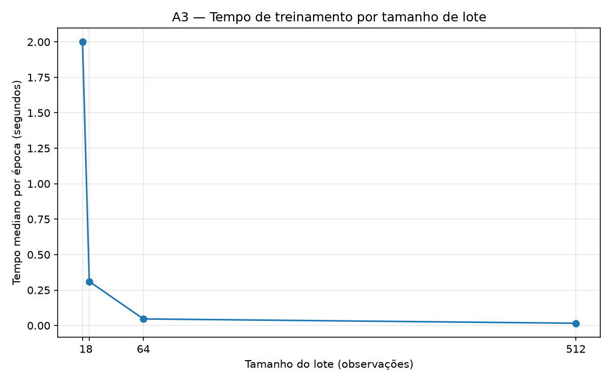
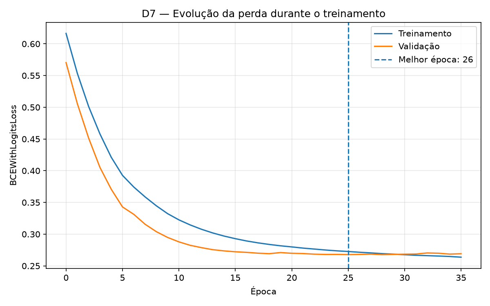
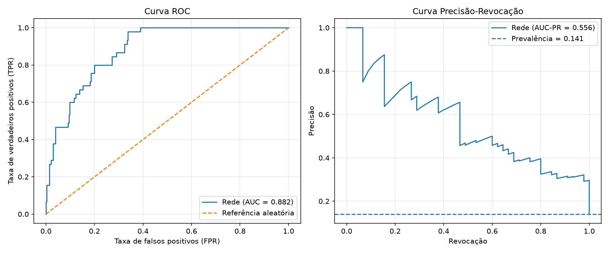

# Lab 2 — Relatório individual

Nome: Carolline de Araújo Mariz
Turma: Banco de Dados - 4º período. 
Link do repositório: https://github.com/Camariz/deep_learning_lab02 

Substitua os marcadores pelas suas medições e análises. Consulte ENUNCIADO.pdf para os requisitos integrais.

## Reprodução
Python: 3.11.9.;
Bibliotecas: NumPy 2.4.6, Pandas 3.0.6, scikit-learn 1.9.1, Matplotlib 3.11.2 e PyTorch 2.14.1.;
Sistema Operacional:Windows (64 bits);
Ambiente de desenvolvimento: Visual Studio Code (VS Code), utilizando ambiente virtual Python (.venv) e Jupyter Notebook.;
Dispositivo: cpu
Semente: 42

Comando ou sequência para executar:

- Clonar o repositório:

git clone https://github.com/Camariz/deep_learning_lab02.git

- Acessar a pasta do projeto:

cd deep_learning_lab02

- Criar e ativar um ambiente virtual Python:

python -m venv .venv
.\.venv\Scripts\Activate.ps1

- Instalar as dependências:

python -m pip install -r requirements.txt

- Abrir a pasta no VS Code, acessar lab02.ipynb, selecionar o interpretador Python do ambiente .venv como kernel e executar todas as células em sequência, utilizando Run All.

Modificações feitas em apoio.py: Não foram realizadas modificações no arquivo apoio.py. As implementações necessárias para substituir os trechos TODO foram desenvolvidas diretamente no notebook lab02.ipynb, utilizando as funções auxiliares disponibilizadas originalmente.

## Base e definição do alvo

Fonte dos dados: Foi utilizada a base pública Red Wine Quality, integrante do conjunto Wine Quality, disponibilizado pelo UCI Machine Learning Repository, com autoria de Cortez et al. (2009). O arquivo `winequality-red.csv` foi fornecido no material da disciplina, dispensando a realização de download externo.

Unidade de observação: Cada linha representa uma observação de vinho tinto, descrita por características físico-químicas e por uma classificação sensorial de qualidade. A base contém 1.599 observações e 11 características preditoras numéricas.

Características utilizadas: Foram consideradas as seguintes variáveis: acidez fixa (fixed acidity), acidez volátil (volatile acidity), ácido cítrico (citric acid), açúcar residual (residual sugar), cloretos (chlorides), dióxido de enxofre livre (free sulfur dioxide), dióxido de enxofre total (total sulfur dioxide), densidade (density), pH, sulfatos (sulphates) e teor alcoólico (alcohol).

Regra do alvo: A variável original `quality` representa a nota sensorial atribuída ao vinho. Para transformar o problema em uma classificação binária, foi adotada a regra estabelecida no laboratório: `alvo = (quality >= 7).astype('int64')`. Dessa forma, a classe 1 corresponde às observações com nota igual ou superior a 7, enquanto a classe 0 representa notas inferiores a 7. A variável `quality` não é utilizada como característica de entrada do modelo, evitando vazamento direto da resposta.

Distribuição das classes: Das 1.599 observações, 217 (13,57%) pertencem à classe positiva e 1.382 (86,43%) à classe negativa. Portanto, a base apresenta desbalanceamento entre as classes, o que exige analisar métricas adicionais à acurácia.

Perfis repetidos: Foram identificados 1.359 perfis físico-químicos distintos. Para reduzir o risco de vazamento de informações, observações com as mesmas 11 características são mantidas na mesma partição durante a separação dos dados.

Limitações: A base não fornece identificadores confiáveis dos vinhos físicos, datas de coleta ou informações suficientes para avaliar diferenças entre produtores e períodos. Portanto, não é possível assegurar a independência entre todas as observações nem avaliar diretamente a generalização temporal ou para novos produtores. Além disso, a classificação binária adotada é uma convenção didática, não uma definição universal de qualidade do vinho.

## B1 — Cinco cenários
1. Avaliações de produtos: [3–5 linhas].
Para avaliar a generalização a novos usuários, adotaria uma partição por identificador de usuário, mantendo suas avaliações em um único conjunto. Essa abordagem evita que padrões individuais de escrita e preferências sejam compartilhados entre treino e teste. Uma divisão aleatória poderia superestimar o desempenho. Para usuários conhecidos, consideraria uma separação temporal, caso existam datas disponíveis.
2. Turbinas: [3–5 linhas].
Adotaria uma partição temporal, utilizando registros anteriores para treinamento e períodos posteriores para avaliação, simulando a previsão de falhas nas próximas 24 horas. Uma divisão aleatória poderia misturar leituras próximas e correlacionadas, comprometendo a independência dos conjuntos. Também evitaria a sobreposição de janelas temporais. Para turbinas desconhecidas, acrescentaria uma separação por equipamento.
3. Spam: [3–5 linhas].
Utilizaria uma partição aleatória estratificada, preservando a proporção de mensagens classificadas como spam, supondo independência entre observações e estabilidade da distribuição. Essa estratégia permitiria avaliar a classificação de novas mensagens da mesma população. Entretanto, duplicatas e campanhas semelhantes poderiam provocar vazamento de padrões. Havendo dependências identificáveis, adotaria uma separação por grupos ou período.
4. Radiografias: [3–5 linhas].
Adotaria uma partição por paciente, assegurando que suas radiografias permaneçam exclusivamente em um dos conjuntos. Essa estratégia busca avaliar a capacidade de generalização para pacientes não observados durante o treinamento. Uma divisão aleatória por imagem poderia compartilhar características individuais entre treino e teste, produzindo estimativas artificialmente otimistas de desempenho.
5. Transações, tempo e clientes: [3–5 linhas].
Adotaria uma separação cronológica para avaliar a detecção de fraudes em transações futuras, evitando o uso indevido de informações posteriores ao momento da previsão. Para clientes conhecidos, preservaria o histórico anterior ao período avaliado. Caso o objetivo fosse generalizar para novos clientes, também separaria os dados por identidade. Uma divisão aleatória poderia introduzir vazamento temporal e compartilhar padrões individuais entre os conjuntos.

## B2 — Auditoria da separação
Pergunta de uso e estratégia: O objetivo é classificar observações de vinho tinto quanto à qualidade sensorial (nota ≥ 7), utilizando 11 características físico-químicas. A base foi dividida em treino, validação e teste, nas proporções aproximadas de 60%, 20% e 20%, por meio do `GroupShuffleSplit`, com semente fixa (42). O agrupamento por perfis físico-químicos idênticos assegurou que observações com as mesmas características permanecessem em uma única partição, reduzindo o risco de vazamento de informações.

| Conjunto | Linhas | Positivos | Proporção positiva | Perfis |
|---|---:|---:|---:|---:|
|Treino | 961 | 139 | 14,46% | 815 |
| Validação | 318 | 33 | 10,38% | 272 |
| Teste | 320 | 45 | 14,06% | 272 |

Cobertura e interseções de índices/perfis: A auditoria confirmou a preservação das 1.599 observações, sem sobreposição de identificadores ou perfis entre quaisquer pares de partições (todas as interseções iguais a zero). Ambas as classes estiveram presentes nos três conjuntos. Observou-se menor proporção de positivos na validação (10,38%), decorrente da separação por grupos sem estratificação de classes. Apesar de reduzir a repetição de perfis entre conjuntos, essa estratégia não garante independência entre vinhos físicos nem generalização para períodos ou produtores não representados nos dados.

## A1 — Dataset
Formas, tipos, estatísticas e verificação:

Foi implementada a classe `MeuDataset`, derivada de `torch.utils.data.Dataset`, com os métodos `__init__`, `__len__` e `__getitem__`, responsáveis pela preparação, dimensionamento e recuperação das observações. A padronização das 11 características foi realizada utilizando exclusivamente a média e o desvio-padrão do conjunto de treino, com a convenção populacional (`ddof=0`) e tratamento de desvios nulos para evitar divisão por zero . As estatísticas calculadas no treinamento foram reutilizadas integralmente na validação e no teste, evitando vazamento de informações durante o pré-processamento. A implementação preservou 961 observações no treino, 318 na validação e 320 no teste. As verificações confirmaram características individuais com dimensão `[11]` e rótulos escalares, ambos do tipo `float32`. Nos lotes de 32 observações, foram obtidas as dimensões `[32, 11]` para as características e `[32]` para os rótulos. Não foram identificados valores NaN ou infinitos em nenhuma partição. A equivalência das médias e dos desvios utilizados nos três conjuntos foi confirmada numericamente. As médias das características padronizadas no treino ficaram aproximadamente iguais a zero, conforme esperado. Esses resultados demonstram a consistência da preparação dos dados e a preservação da separação entre treinamento e avaliação.

## A2 — DataLoader

Foram configurados três DataLoaders em PyTorch, destinados ao treinamento, à validação e ao teste, respeitando as características de cada etapa. As configurações buscaram garantir o processamento integral das observações, preservar o alinhamento entre previsões e rótulos e reduzir a sobrecarga computacional.

| Conjunto | batch_size | shuffle | drop_last | num_workers | Justificativas |
|---|---:|---|---|---:|---|
| Treino | 32 | True | False | 0 | O lote de 32 observações permite atualizações frequentes dos parâmetros. O embaralhamento modifica a composição dos lotes entre épocas, enquanto `drop_last=False` preserva todas as 961 observações. |
| Validação | 64 | False | False | 0 | O lote de 64 permite avaliar os dados em menos iterações. A ausência de embaralhamento e descarte mantém a ordem e preserva as 318 observações. |
| Teste | 64 | False | False | 0 | A configuração assegura a avaliação integral das 320 observações, sem embaralhamento ou descarte, preservando o alinhamento entre previsões e rótulos. |

A escolha de `num_workers=0` nos três carregadores considera o tamanho reduzido da base e a execução em CPU, evitando a sobrecarga associada à criação de processos auxiliares. Essa escolha é uma opção inicial de simplicidade e estabilidade, não uma aceleração comprovada experimentalmente.A execução confirmou 31 lotes no treinamento, cinco na validação e cinco no teste. A configuração `drop_last=False` assegurou que nenhuma observação fosse descartada, inclusive no último lote incompleto do treinamento.

## A3 — Tempo por época

O tempo de treinamento foi avaliado utilizando tamanhos de lote de 1, 8, 64 e 512 observações, com três repetições por configuração. Foi utilizada uma rede neural sem BatchNorm, com arquitetura e parâmetros de otimização constantes, reinicialização dos pesos a partir de um mesmo estado e criação de um novo otimizador a cada repetição. As medições compreenderam uma época completa, incluindo propagação direta, cálculo da perda, retropropagação e atualização dos parâmetros.

| Lote | Repetição 1 (s) | Repetição 2 (s) | Repetição 3 (s) | Mediana (s) | Passos |
|---|---|---|---|---|---|
| 1 | 0,8903 | 1,0002 | 1,6123 | 1,0002 | 961 |
| 8 | 0,2292 | 0,2280 | 0,2081 | 0,2280 | 121 |
| 64 | 0,0417 | 0,0403 | 0,0377 | 0,0403 | 16 |
| 512 | 0,0244 | 0,0145 | 0,0150 | 0,0150 | 2 |

Método de medição: Os experimentos foram realizados em ambiente Windows, utilizando CPU Intel Core i7-10510U @ 1.80 GHz, com PyTorch 2.14.1+cpu. O tempo de execução foi registrado em segundos por meio de `time.perf_counter()`, após uma etapa de aquecimento não contabilizada nas medições. Cada execução processou integralmente as 961 observações do conjunto de treino, com três repetições por tamanho de lote. 

Análise dos resultados: Observou-se redução progressiva do tempo mediano por época com o aumento do tamanho dos lotes, passando de 1,0002 segundo (lote 1) para 0,0150 segundo (lote 512), correspondente a uma redução aproximada de 98,5%. A redução do tempo tornou-se menos expressiva em termos absolutos entre os lotes 64 e 512, sugerindo retornos decrescentes no desempenho computacional para os tamanhos de lote avaliados. Lotes menores exigiram mais atualizações dos parâmetros, aumentando o custo acumulado de execução. Entretanto, o menor tempo por época não implica necessariamente melhor desempenho preditivo, pois diferentes tamanhos de lote também modificam a quantidade de atualizações e a dinâmica do treinamento.

Custo médio por atualização: O custo médio aproximado por atualização aumentou de 1,04 ms, no lote unitário, para 7,52 ms, no lote de 512 observações. Apesar do maior custo individual dos passos com lotes grandes, a redução expressiva do número de atualizações resultou em menor tempo total por época. Essa análise representa uma estimativa obtida pela divisão do tempo mediano pelo número de passos, não uma medição individual de cada atualização.

Figura 1 — Tempo mediano de treinamento por época em função do tamanho do lote.

Fonte: elaboração própria, a partir das medições realizadas em CPU.

## A4 — BatchNorm

Condição do erro: Foi utilizado um subconjunto de 65 observações, extraídas exclusivamente do conjunto de treinamento, com tamanho de lote igual a 64 e uma rede neural contendo `BatchNorm1d` em modo de treinamento. Como o resto da divisão foi igual a 1, o último lote apresentou apenas uma observação, impossibilitando o cálculo adequado das estatísticas necessárias à normalização.

Mensagem capturada: `ValueError: Expected more than 1 value per channel when training, got input size torch.Size([1, 16])`

Correção e consequência: O problema foi corrigido mediante a configuração de `drop_last=True`, que descartou o último lote incompleto. Após a alteração, o treinamento foi executado com sucesso, processando 64 observações em um único lote e descartando uma observação (1,54% do subconjunto). A perda registrada foi de 0,7391. Embora eficaz para demonstrar a correção, essa abordagem reduz a quantidade de dados utilizados no treinamento. Alternativas incluem ajustar o tamanho dos lotes ou empregar métodos de normalização que não dependam das estatísticas do lote. O procedimento foi restrito ao experimento A4, sem modificar os carregadores ou as partições utilizadas na avaliação principal.

## C — Duas formas de vazamento

Foram avaliados dois mecanismos de vazamento de dados (*data leakage*) utilizando a base Red Wine Quality. Os experimentos foram conduzidos em partições internas do conjunto de desenvolvimento, empregando regressão logística e acurácia como métrica. Para cada mecanismo, comparou-se um procedimento metodologicamente incorreto com sua versão corrigida.

| Forma | Dados e partições internas | Métrica | Incorreto | Corrigido | Diferença/unidade |
|---|---|---|---|---|---|
| 1 — Pré-processamento indevido | Red Wine Quality; treino interno (961) e avaliação interna (318) | Acurácia | 87,42% | 87,42% | 0,00 p.p. |
| 2 — Inclusão do alvo | Red Wine Quality; treino interno (961) e avaliação interna (318) | Acurácia | 100,00% | 87,42% | +12,58 p.p. |

Experimento 1 — mecanismo, comparação e limites: O primeiro experimento investigou o ajuste indevido da padronização utilizando as características dos conjuntos internos de treinamento e avaliação. O procedimento incorreto e sua versão corrigida apresentaram a mesma acurácia (87,42%), sem diferença observável nessa métrica. Contudo, houve vazamento porque a distribuição das características reservadas à avaliação influenciou o cálculo da média e do desvio-padrão. Esse achado demonstra que a ausência de alteração na acurácia não assegura a integridade metodológica do procedimento, uma vez que o impacto do vazamento depende das características dos dados, do modelo e da métrica utilizada.

Experimento 2 — mecanismo, comparação e limites: O segundo experimento avaliou a inclusão da variável `alvo` como característica adicional, juntamente às 11 variáveis físico-químicas. O procedimento incorreto alcançou acurácia de 100,00%, enquanto a versão corrigida apresentou 87,42%, representando uma diferença de 12,58 pontos percentuais. Esse resultado decorre do acesso indevido à própria resposta durante o treinamento e a avaliação, caracterizando vazamento direto do alvo. Portanto, o desempenho aparentemente perfeito não representa capacidade legítima de generalização, mas uma estimativa artificialmente favorecida por informação indisponível no momento real da previsão.

Como preservei o teste principal: Os experimentos utilizaram exclusivamente as 1.279 observações provenientes dos conjuntos de treino e validação da Parte B2, reorganizadas em treino interno (961 observações) e avaliação interna (318 observações). A auditoria confirmou ausência de sobreposição de identificadores com as 320 observações do teste principal, além de inexistência de perfis compartilhados entre as partições internas. Dessa forma, o teste principal permaneceu reservado para a avaliação independente da Parte D, sem participação nos experimentos de vazamento ou nas escolhas realizadas nesta etapa.

## D7 — Treinamento e parada
Arquitetura, otimizador e parâmetros de treinamento: Foi implementada uma rede neural de classificação binária em PyTorch, com arquitetura 11 → 16 → 1, camada oculta com ativação ReLU e sem BatchNorm. O treinamento utilizou o otimizador Adam, com taxa de aprendizagem de 0,001, e a função de perda BCEWithLogitsLoss, sem ponderação de classes. A estratégia de parada antecipada (Early Stopping) foi configurada com limite máximo de 100 épocas, paciência de 10 épocas consecutivas e melhoria mínima (min_delta) de 0,0001, monitorando exclusivamente a perda de validação.

Melhor época, época de parada, motivo e restauração: A menor perda de validação selecionada pelo critério de melhoria foi de 0,267829, registrada na época 26. O treinamento foi interrompido na época 36, após dez épocas consecutivas sem melhoria suficiente. Os pesos da melhor época foram preservados por meio de uma cópia independente do state_dict e restaurados ao término do treinamento, com confirmação numérica bem-sucedida (True). Dessa forma, o modelo final manteve os parâmetros selecionados pela validação, sem utilizar informações do conjunto de teste.

Curvas de perda: Observou-se redução progressiva das perdas de treinamento e validação nas primeiras épocas, seguida de estabilização da perda de validação. Esse comportamento sustentou a aplicação da parada antecipada, evitando a continuidade do treinamento sem melhoria relevante segundo o critério estabelecido. Embora esse procedimento contribua para controlar o sobreajuste, não garante, isoladamente, a capacidade de generalização do classificador.

Figura 2 — Evolução das perdas de treinamento e validação.

Fonte: elaboração própria, a partir dos resultados experimentais.

## D4 — Matriz de custos
Ação, C_FP, C_FN, unidade e justificativa: O classificador tem como finalidade apoiar a seleção de amostras de vinho tinto para uma análise especial, considerando positivas aquelas com nota sensorial igual ou superior a 7. A previsão positiva implica selecionar a amostra, enquanto a negativa indica sua não seleção. Foram definidos custos hipotéticos de 2 unidades para falsos positivos (C_FP = 2) e 5 unidades para falsos negativos (C_FN = 5), atribuindo-se custo zero às classificações corretas. A maior penalização dos falsos negativos reflete a prioridade de identificar vinhos de alta qualidade, mesmo que isso implique selecionar algumas amostras inadequadas.

Hipóteses e origem dos custos: Os custos foram estabelecidos exclusivamente para fins didáticos, em unidades abstratas, sem correspondência com valores financeiros ou operacionais observados na base de dados. Considerou-se que deixar de selecionar um vinho de alta qualidade representa uma perda de oportunidade superior ao esforço adicional de analisar uma amostra com nota inferior a 7. Admitiu-se, ainda, que os custos sejam constantes por tipo de erro e nulos para decisões corretas. Essas hipóteses fundamentam a posterior escolha do limiar de classificação com base no conjunto de validação.

## D5 e D6 — Escolha na validação

Candidatos, desempate e comparação de custos: O limiar de decisão foi selecionado exclusivamente no conjunto de validação (n = 318), considerando 274 candidatos derivados dos escores únicos do modelo e dos extremos de classificação. Adotou-se como critério a minimização do custo total, com preferência pelo maior limiar em caso de empate. O limiar empírico escolhido foi 0,276928, resultando em custo total de 114 unidades hipotéticas e custo médio de 0,3585 por observação. Em comparação, o limiar padrão de 0,5 apresentou custo total de 162 unidades e custo médio de 0,5094. A redução observada foi de 48 unidades, equivalente a aproximadamente 29,63%.

Comparação com a fórmula teórica: Considerando os custos previamente definidos (C_FP = 2 e C_FN = 5), o limiar teórico calculado por C_FP/(C_FP + C_FN) foi de 0,285714, próximo ao limiar empírico de 0,276928, com diferença de −0,008786. Na validação, o limiar teórico apresentou custo total de 119 unidades. A pequena divergência pode estar relacionada ao tamanho da amostra, à distribuição dos escores e à possível calibração imperfeita das previsões. O Brier score foi de 0,079785, fornecendo uma medida complementar do erro probabilístico, sem assegurar calibração perfeita.

Configuração congelada antes do teste: Após a seleção do limiar, foram fixados a arquitetura e os pesos restaurados do modelo, as 11 características preditoras, as estatísticas de padronização calculadas exclusivamente no treino, os custos de classificação (C_FP = 2; C_FN = 5) e o limiar de 0,276928. A decisão foi registrada como decisao_congelada = True, sem utilização do conjunto de teste. Os resultados da validação foram empregados apenas para orientar a decisão, permanecendo o teste reservado para a avaliação independente final.

## D1 e D2 — Avaliação final

Proporção positiva, classificador trivial e convenções: A avaliação final foi realizada em 320 observações previamente reservadas, das quais 45 (14,06%) pertenciam à classe positiva. O classificador trivial, definido pela classe majoritária do treinamento (classe 0), apresentou acurácia de 85,94%, porém revocação e F1 iguais a zero, evidenciando sua incapacidade de identificar vinhos de alta qualidade. Para situações sem previsões positivas, adotou-se precisão igual a zero. As áreas AUC-ROC e AUC-PR do classificador trivial não foram reportadas.

Matrizes de confusão e tabela de métricas/custos:

A avaliação final foi realizada em 320 observações do conjunto de teste, sendo 45 (14,06%) pertencentes à classe positiva. Foram comparados o classificador trivial, o limiar padrão de 0,5 e o limiar de 0,276928, previamente selecionado na validação.

| Regra | Limiar | Acurácia | Precisão | Revocação | F1 | AUC-ROC | AUC-PR trapezoidal | Custo médio |
|---|---:|---:|---:|---:|---:|---:|---:|---:|
| Trivial do treino | — | 0,8594 | 0,0000 | 0,0000 | 0,0000 | — | — | 0,7031 |
| Rede — padrão | 0,5000 | 0,8750 | 0,6190 | 0,2889 | 0,3939 | 0,8816 | 0,5562 | 0,5500 |
| Rede — limiar escolhido | 0,276928 | 0,8438 | 0,4576 | 0,6000 | 0,5192 | 0,8816 | 0,5562 | 0,48125 |

Matriz de confusão — limiar padrão (0,5)

| Classe real / Prevista | Classe 0 | Classe 1 |
|---|---:|---:|
| Classe 0 | 267 | 8 |
| Classe 1 | 32 | 13 |

Matriz de confusão — limiar escolhido (0,276928)

| Classe real / Prevista | Classe 0 | Classe 1 |
|---|---:|---:|
| Classe 0 | 243 | 32 |
| Classe 1 | 18 | 27 |

As matrizes apresentam as classes reais nas linhas e as classes previstas nas colunas, seguindo a ordem 0 e 1.

Interpretação: A adoção do limiar escolhido aumentou a revocação de 28,89% para 60,00%, reduzindo os falsos negativos de 32 para 18. Embora tenha ocorrido redução da acurácia e da precisão, o custo total hipotético diminuiu de 176 para 154 unidades, representando uma redução de 12,5% em relação ao limiar padrão. Esses resultados evidenciam a importância de considerar os custos dos erros e a finalidade da classificação, em vez de utilizar apenas a acurácia.

Distinção entre AUC-PR e AP: A AUC-PR apresentada (0,5562) foi calculada por integração trapezoidal da curva precisão-revocação, utilizando `auc(recall, precision)` da biblioteca scikit-learn. A métrica *Average Precision* (AP), calculada por `average_precision_score`, utiliza um procedimento distinto e não foi estimada neste experimento. Portanto, o valor 0,5562 refere-se exclusivamente à AUC-PR trapezoidal, não devendo ser interpretado como AP.

## D3 — Curvas

As curvas ROC (Receiver Operating Characteristic) e Precisão-Revocação (Precision-Recall) foram construídas a partir dos escores contínuos produzidos pela rede neural no conjunto de teste (n = 320). A curva ROC apresentou área sob a curva (AUC-ROC) de 0,8816, indicando capacidade discriminativa superior à referência de classificação aleatória, representada pela diagonal entre os pontos (0,0) e (1,1), cuja área corresponde a 0,5.

A curva Precisão-Revocação apresentou AUC-PR trapezoidal de 0,5562, superior à prevalência da classe positiva no teste (14,06%), utilizada como referência horizontal. Esse resultado evidencia a capacidade do modelo de identificar observações positivas em diferentes níveis de revocação, aspecto relevante diante do desbalanceamento das classes.

As áreas permaneceram inalteradas para os limiares de 0,5 e 0,276928, uma vez que a alteração do limiar modifica as decisões binárias, mas não os escores nem a ordenação das observações. Apesar dos resultados favoráveis, as métricas refletem o desempenho na amostra avaliada e não garantem generalização para outras populações ou períodos.

Figura 3 — Curvas ROC e Precisão-Revocação do classificador no conjunto de teste.

 

Fonte: elaboração própria, a partir dos resultados experimentais obtidos no conjunto de teste.

## D8 — Recomendação

Recomenda-se utilizar a rede neural com limiar de decisão de 0,276928 como ferramenta de apoio à identificação de vinhos de alta qualidade (nota ≥ 7), especialmente em situações nas quais deixar de identificar um vinho positivo representa um custo maior do que selecionar indevidamente uma amostra negativa. Essa recomendação baseia-se na avaliação final realizada em 320 observações do conjunto de teste, com 45 casos positivos (14,06%). O modelo apresentou AUC-ROC de 0,8816, AUC-PR trapezoidal de 0,5562, revocação de 60,00% e F1 de 0,5192 com o limiar escolhido. Considerando os custos hipotéticos previamente definidos (C_FP = 2 e C_FN = 5), o custo total foi de 154 unidades, equivalente a 0,48125 por observação, inferior às 176 unidades obtidas com o limiar padrão de 0,5 e às 225 unidades do classificador trivial. Entretanto, o aumento dos falsos positivos de 8 para 32 evidencia a necessidade de avaliar os recursos disponíveis para verificar as amostras selecionadas. Além disso, o modelo deixou de identificar 18 dos 45 casos positivos, demonstrando que ainda existe risco de decisões incorretas. Os custos utilizados são ilustrativos e não representam valores econômicos efetivamente mensurados. Assim, recomenda-se a utilização do modelo apenas como apoio à decisão, acompanhada de validação adicional, monitoramento e avaliação dos custos reais antes de uma eventual aplicação operacional. Os resultados apresentados são restritos ao conjunto de teste avaliado e não permitem afirmar desempenho equivalente em outros produtores, regiões, períodos ou populações não observadas.

## Referências e limites

Referências

Cortez, P., Cerdeira, A., Almeida, F., Matos, T., & Reis, J. (2009). Modeling wine preferences by data mining from physicochemical properties. Decision Support Systems, 47(4), 547–553. https://doi.org/10.1016/j.dss.2009.05.016

UCI Machine Learning Repository. Wine Quality Dataset. University of California, Irvine. https://archive.ics.uci.edu/dataset/186/wine+quality

PyTorch. Documentação oficial: Dataset, DataLoader, treinamento e funções de perda. https://docs.pytorch.org/docs/stable/index.html

Scikit-learn. Documentação oficial: particionamento de dados, métricas de classificação e avaliação de modelos. https://scikit-learn.org/stable/

CESAR School. Material didático e código de apoio disponibilizados para o Laboratório 02 de Deep Learning.

Limitações e incertezas

Os resultados deste estudo devem ser interpretados considerando as características do conjunto Wine Quality, composto por 1.599 registros de vinho tinto e 11 variáveis físico-químicas. O desbalanceamento entre as classes e a avaliação em um único conjunto de teste (n = 320) podem influenciar a estabilidade das métricas, especialmente porque não foram estimados intervalos de confiança nem investigada a variabilidade entre diferentes particionamentos.

Além disso, os custos atribuídos aos erros de classificação são hipotéticos e não representam valores econômicos reais. Embora o Brier score tenha sido calculado na validação, não foi realizada uma avaliação aprofundada da calibração das probabilidades. Também não foram exploradas sistematicamente diferentes arquiteturas ou estratégias de otimização.

Por fim, a ausência de validação externa e de análises de robustez limita a generalização dos resultados. Portanto, o desempenho observado não deve ser automaticamente estendido a outros produtores, regiões, períodos ou condições de produção sem novas avaliações.
